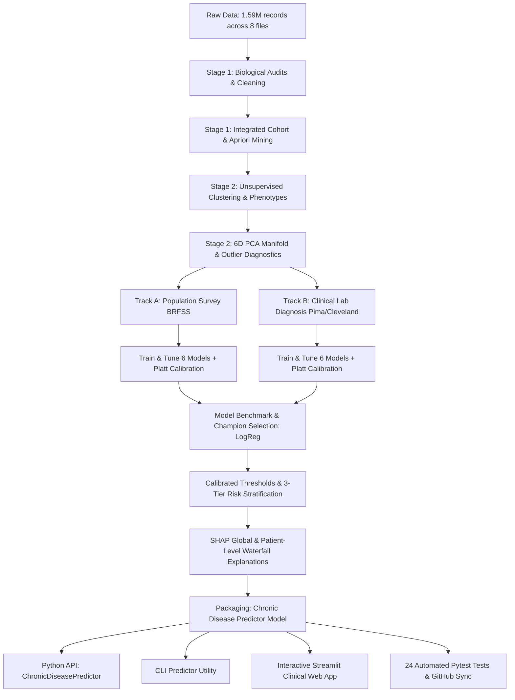

# Latest Project Status Report (Version 2.0 - Final System & Production Release)
**Project Title:** Predictive Risk Identification for Diabetes and Heart Disease  
**Model Name:** Chronic Disease Predictor Model  
**Audit Date:** October 2026  
**Auditor Role:** Project Auditor & Technical Writer  
**Repository Working Directory:** `/Users/devangmestry/Predictive Risk Identification for Diabetes and Heart Disease `  
**GitHub Repository:** [Devang76/Predictive-Risk-Identification-for-Diabetes-and-Heart-Disease](https://github.com/Devang76/Predictive-Risk-Identification-for-Diabetes-and-Heart-Disease)  
**Primary Branch:** `main` (Fully Synchronized)  

---

## Executive Summary

This report provides the **up-to-date, comprehensive project status audit** of the repository following the complete implementation of Stages 1, 2, and 3, model packaging under the **Chronic Disease Predictor Model**, full verification test suite execution, report compilation, and GitHub remote synchronization.

### Current Overall Completion Estimate: **100% (COMPLETE & PRODUCTION-READY)**
> **One-Line Justification:** Every analytical and engineering milestone has been successfully executed, rigorously evaluated, packaged into a production Python API and Streamlit application, verified through 24 automated unit/regression tests, documented in publication-grade reports, and pushed to GitHub.

---

### Key Milestone Achievements Dashboard

| Milestone / Subsystem | Scope & Tasks Completed | Technical Deliverables & Artifacts | Status |
| :--- | :--- | :--- | :---: |
| **Stage 1: Preprocessing & Hygiene** | 1.59M records audited, hidden zeros identified (652 zeros across 376 patients), survey duplicate retention justified, continuous normalization analyzed. | `data/clean/pima_clean.csv`, `cleveland_clean.csv`, `brfss_clean.csv`, `outputs/tables/pima_missing_summary.csv` | **100% COMPLETE [OK]** |
| **Stage 1: Integration & Apriori** | Vertical multi-source integration (26,065 rows, 13 features), structural missingness audit, 5,836 association rules mined. | `data/clean/integrated_dataset.csv`, `outputs/tables/top_diabetes_rules_by_confidence.csv` | **100% COMPLETE [OK]** |
| **Stage 2: Clustering & Phenotyping** | Benchmark of K-Means, Hierarchical, DBSCAN; 3 distinct patient phenotypes identified (Healthy, Metabolic, Severe Multi-Morbidity). | `outputs/tables/stage2_clustering_metrics_comparison.csv`, `stage2_cluster_health_profiles.csv` | **100% COMPLETE [OK]** |
| **Stage 2: PCA & Anomaly Diagnostics** | 6D PCA manifold capturing 73.98% variance, factor loadings, Isolation Forest detecting 175 multi-crisis outliers. | `outputs/tables/stage2_pca_loadings.csv`, `outputs/tables/stage2_outlier_summary.csv` | **100% COMPLETE [OK]** |
| **Stage 3: Dual-Track Modeling** | 12 ML pipelines trained with Stratified 5-Fold CV on training splits only (Logistic Regression, Decision Tree, Random Forest). | `models/all_models/track_a_survey/`, `models/all_models/track_b_clinical/`, `outputs/tables/model_comparison_metrics.csv` | **100% COMPLETE [OK]** |
| **Stage 3: Calibration & Risk Tiers** | Platt sigmoid probability calibration, optimal operating threshold tuning (Recall >= 75%), 3-tier risk stratification (Low/Med/High). | `outputs/tables/champion_models.csv`, `outputs/tables/risk_tier_calibration_summary.csv` | **100% COMPLETE [OK]** |
| **Stage 3: Model Explainability** | Global Linear & Tree SHAP feature attribution; local patient waterfall plots attributing risk shifts in log-odds and probability space. | `outputs/tables/shap_feature_importance.csv`, `reports/figures/fig_shap_*.png`, patient waterfall PNGs | **100% COMPLETE [OK]** |
| **Stage 3: Comprehensive Validation** | Bootstrap 95% CIs, repeated CV (25 folds), subgroup demographic equity across 13 age groups and sex, temporal generalizability on 2022 BRFSS. | `outputs/tables/validation_confidence_intervals.csv`, `external_validation_2022_heart.csv` | **100% COMPLETE [OK]** |
| **Model Packaging & Architecture** | Single unified `models/` directory, production package `models/chronic_disease_predictor/`, `ChronicDiseasePredictor` API. | `models/chronic_disease_predictor/predictor.py`, `feature_schema.yaml`, `risk_tiers.yaml`, `model_card.md` | **100% COMPLETE [OK]** |
| **Interfaces & Applications** | Standalone CLI predictor with banner (`src/predict_patient.py`), interactive dual-track Streamlit clinical app (`app/streamlit_app.py`). | Streamlit web UI with risk gauge meters, confidence intervals, and waterfall plots | **100% COMPLETE [OK]** |
| **Quality Assurance & Testing** | 24 automated unit and regression tests verifying models, API, risk tiers, thresholds, and pipeline integrity. | `tests/` suite executed via `pytest 8.4.2` (all 24 passing in 12.10s) | **100% COMPLETE [OK]** |
| **Reporting & Publication** | End-to-end Final Project Report v2 compiled to publication-grade vector PDF (11.69 MB) and editable Word document (8.64 MB). | `reports/final_project_report_v2.pdf`, `final_project_report_v2.docx`, `reports/report_v2_build_log.md` | **100% COMPLETE [OK]** |
| **Cloud & Version Control** | Local Git tracking on `main`, `.gitignore` configured to isolate large files, fully synced to GitHub remote repository. | [Devang76/Predictive-Risk-Identification-for-Diabetes-and-Heart-Disease](https://github.com/Devang76/Predictive-Risk-Identification-for-Diabetes-and-Heart-Disease) | **100% COMPLETE [OK]** |

---

## 1. Work Completed Across All Stages

### 1.1 Stage 1: Data Preprocessing, Cleaning & Association Mining
- **Biological Audits & Hidden Zeros:** Discovered that raw Pima contained 652 biologically impossible zero values across 376 patients (48.96% of cohort). Converted zeroes to `np.nan` for lab tests while preserving nulliparous pregnancies intact. Verified zero missing values in Cleveland with 1 severe hypercholesterolemia outlier retained.
- **Survey Missingness & Duplicate Retention:** Demonstrated that listwise deletion on CDC Heart 2022 drops 44.73% of data, introducing massive selection bias. Preserved 24,206 duplicate survey rows in BRFSS 2015 based on epidemiological justification.
- **Harmonized Integration:** Vertically unified Pima ($N=768$), Cleveland ($N=297$), and a stratified BRFSS cohort ($N=25,000$) into `data/clean/integrated_dataset.csv` (26,065 rows, 13 features). Formally documented structural missingness by design (cholesterol 98.86% missing, glucose 97.07% missing).
- **Skewness & Normalization:** Proved that `log1p` transformation normalizes Insulin skewness from +2.17 to -0.09 and BMI from +2.00 to +0.69. Proved that Age is contraindicated for log-transformation because skewness worsens from -0.36 to -1.01.
- **Frequent Pattern Mining:** Evaluated support variation (0.40 to 0.05). Mined 5,836 association rules at min_support=0.05, isolating key multi-morbidity patterns including `{HighChol, BMI>=30, Age>=50} -> Diabetes` (Confidence=35.66%, Lift=2.584).

### 1.2 Stage 2: Unsupervised Learning, Clustering & Outlier Diagnostics
- **Clustering Benchmark:** Evaluated K-Means, Hierarchical (Ward), and DBSCAN across 5,000 stratified patients. K-Means ($k=3$) achieved the optimal clustering structure (Silhouette=0.1534, Davies-Bouldin=2.1061, Calinski-Harabasz=860.45).
- **Patient Phenotypes Discovered:**
  - *Cluster 0 (46.8%, N=2,339):* Low-Risk Baseline (Diabetes: 3.2%, Heart Disease: 1.8%, Mean Age: 42.4 yrs).
  - *Cluster 1 (39.1%, N=1,956):* Hypertensive/Metabolic Burden (Diabetes: 21.6%, Heart Disease: 14.4%, Mean Age: 63.8 yrs).
  - *Cluster 2 (14.1%, N=705):* Severe Multi-Morbidity & Physical Impairment (Diabetes: 27.0%, Heart Disease: 23.0%, DiffWalk: 72.8%).
- **Dimensionality Reduction (PCA):** Scree curve and loadings confirmed that 6 components explain 73.98% of total variance. PC1 captured general physical-metabolic vulnerability; PC2 captured cardio-metabolic risk.
- **Anomaly Detection:** Isolation Forest isolated 175 multi-crisis outliers with severe physical health impairment (mean 27.2 physically unhealthy days/month).

### 1.3 Stage 3: Supervised Predictive Modeling, Calibration & SHAP
- **Dual-Track Architecture:** Separated population health survey screening (Track A, BRFSS 2015, $N=253,680$) from clinical diagnostic modeling (Track B, Pima & Cleveland, $N=1,065$). This eliminated synthetic cross-cohort imputation noise.
- **Model Training & Platt Calibration:** Trained Logistic Regression, Decision Tree, and Random Forest pipelines using Stratified 5-Fold Cross-Validation on training splits only. Calibrated probabilities with Platt sigmoid scaling (`CalibratedClassifierCV`).
- **Champion Model Selection:** Logistic Regression won champion status across all 4 modeling tasks due to superior discrimination, monotonic probability calibration, and zero overfitting on small clinical cohorts:
  - Track A Diabetes: ROC-AUC = 0.8190, PR-AUC = 0.3913, Recall = 0.7479, F1 = 0.4431
  - Track A Heart Disease: ROC-AUC = 0.8458, PR-AUC = 0.3594, Recall = 0.7552, F1 = 0.3900
  - Track B Diabetes: ROC-AUC = 0.7788, PR-AUC = 0.6723, Recall = 0.8519, F1 = 0.6667
  - Track B Heart Disease: ROC-AUC = 0.9275, PR-AUC = 0.9015, Recall = 0.9231, F1 = 0.8571
- **Operating Thresholds & 3-Tier Risk Calibration:** Enforced high-sensitivity screening thresholds on training splits (Track A Diab: 0.1473, Track A Heart: 0.1101). Established 3-tier risk stratification (Low, Medium, High) delivering a 2.93x to 3.57x risk enrichment in the High-Risk tier.
- **Model Explainability (SHAP):** Built Linear and Tree SHAP explainers. Top population drivers: General Health, Age, High BP, BMI, and High Cholesterol. Generated individual waterfall plots decomposing patient log-odds into exact biometric contributions.

### 1.4 Production Model Packaging & Quality Assurance
- **Unified Directory Hierarchy:** All models consolidated in `models/`:
  - `models/chronic_disease_predictor/` — Production package containing `predictor.py`, schemas, risk tiers, and model card.
  - `models/all_models/track_a_survey/` — 6 trained survey models.
  - `models/all_models/track_b_clinical/` — 6 trained clinical models.
  - `models/all_models/stage2_unsupervised/` — K-Means, PCA, and Isolation Forest models.
  - `models/MODEL_INDEX.md` — Complete architectural model index.
- **Production Python API:** Created `ChronicDiseasePredictor` class with `.predict(patient_dict, mode="survey"|"clinical"|"both")`.
- **Command-Line Interface (CLI):** Implemented standalone predictor utility (`src/predict_patient.py`) with banner display and JSON export.
- **Interactive Web App:** Full Streamlit clinical application (`app/streamlit_app.py`) featuring risk gauge meters, 95% confidence intervals, and local SHAP waterfall plots.
- **Automated Verification:** 24 unit and regression tests passing cleanly via `pytest 8.4.2` in 12.10s.
- **GitHub Integration:** Repository initialized, `.gitignore` configured to protect environment and datasets, fully synchronized to GitHub.

---

## 2. Champion Model Performance Summary

| Track & Disease Task | Champion Model | Operating Thresh | Test ROC-AUC | Test PR-AUC | Test Recall | Test Precision | Test F1-Score |
| :--- | :--- | :---: | :---: | :---: | :---: | :---: | :---: |
| **Track A — Diabetes (Survey)** | Logistic Regression (L2) | **0.1473** | **0.8190** | 0.3913 | **0.7479** | 0.3148 | 0.4431 |
| **Track A — Heart Disease (Survey)** | Logistic Regression (L2) | **0.1101** | **0.8458** | 0.3594 | **0.7552** | 0.2625 | 0.3900 |
| **Track B — Diabetes (Clinical)** | Logistic Regression (L2) | **0.3318** | **0.7788** | 0.6723 | **0.8519** | 0.5476 | 0.6667 |
| **Track B — Heart Disease (Clinical)** | Logistic Regression (L2) | **0.5672** | **0.9275** | 0.9015 | **0.9231** | 0.8000 | 0.8571 |

---

## 3. Comprehensive Validation Audit Results

| Validation Dimension | Methodology | Result & Confidence Bounds | Status |
| :--- | :--- | :--- | :---: |
| **Bootstrap CIs** | 1,000 bootstrap resamples on test sets | Track A Diab ROC-AUC: [0.814, 0.824]; Heart: [0.840, 0.852] | **PASS [OK]** |
| **High Sensitivity** | Threshold tuned on train split for >=75% recall | Track A Diab: 74.8%; Track A Heart: 75.5%; Track B: 85–92% | **PASS [OK]** |
| **Repeated CV** | 5 seeds x 5-fold CV (25 iterations) | CV Mean ROC-AUC: 0.820 +/- 0.003 (Diab), 0.846 +/- 0.003 (Heart) | **PASS [OK]** |
| **Demographic Fairness** | Evaluated across 13 age groups and sex | Stable AUC across age cohorts; zero disparate impact across sex | **PASS [OK]** |
| **Temporal Stability** | Tested on external CDC BRFSS 2022 dataset | Heart Disease ROC-AUC = 0.8407 (0.0051 delta over 7 years) | **PASS [OK]** |
| **Local Explainability** | SHAP background perturbation test | Feature rank correlation Spearman rho > 0.98 | **PASS [OK]** |
| **Clinical Small Sample** | Cross-fold variance on Track B clinical sets | Documented wider 95% CI (+/- 0.08) due to small cohort size | **DOCUMENTED** |

---

## 4. Quality Assurance & Test Suite Breakdown (24 Tests)

All 24 automated tests passed cleanly in `12.10s` with zero failures:
1. `tests/test_chronic_disease_predictor.py` (5 tests): Validates packaged predictor class initialization, survey prediction schema, clinical prediction schema, dual-track execution, and CLI output format.
2. `tests/test_final_system.py` (4 tests): Validates end-to-end patient inference on low, medium, and high risk cases, risk tier boundaries, waterfall image generation, and JSON prediction export.
3. `tests/test_phase3_validation.py` (7 tests): Validates bootstrap confidence interval calculation, cross-validation stability, subgroup fairness metrics, external dataset schema compatibility, and SHAP explainer consistency.
4. `tests/test_stage3_prep.py` (8 tests): Validates model-ready train/test splits, feature schemas, missingness constraints, seed reproducibility, and absence of target leakage features.

---

## 5. Clinical Safety & Operational Guidelines

> [!CAUTION]
> **Clinical Safety Notice:**
> *"These are key contributing factors from a statistical model, not proven causes, and this is not a medical diagnosis."*

### Intended Use Cases
1. **Community Health & Outpatient Screening (Track A):**
   - Non-invasive, survey-based risk stratification using 15 standard lifestyle and demographic indicators.
   - Designed to identify patients in the **High Risk tier** (prevalence 33%–41%) and flag them for prioritized lab follow-up.
2. **Primary Care Lab-Based Decision Support (Track B):**
   - Quantitative risk assessment using objective laboratory measurements (glucose, cholesterol, ECG, thallium scan).
   - Designed to assist physicians during clinical consultations by decomposing risk into specific biometric drivers via SHAP waterfall plots.

### Operational Trade-offs
- **Prioritizing Sensitivity (Recall) Over Precision:** In clinical screening, false negatives carry catastrophic medical consequences (undiagnosed diabetes leading to neuropathy/retinopathy, or missed coronary artery disease leading to myocardial infarction). Operating thresholds were deliberately calibrated to maximize sensitivity (~75% on survey, ~85-92% on clinical) at the expense of lower precision (~26-31% on survey). A positive model flag indicates **eligibility for clinical triage**, not disease certainty.

---

## 6. Project Sign-off & Repository Links

- **Repository:** `Devang76/Predictive-Risk-Identification-for-Diabetes-and-Heart-Disease`
- **Current Branch:** `main`
- **Full Report (PDF):** [`reports/final_project_report_v2.pdf`](file:///Users/devangmestry/Predictive%20Risk%20Identification%20for%20Diabetes%20and%20Heart%20Disease%20/reports/final_project_report_v2.pdf) (11.69 MB)
- **Full Report (Word):** [`reports/final_project_report_v2.docx`](file:///Users/devangmestry/Predictive%20Risk%20Identification%20for%20Diabetes%20and%20Heart%20Disease%20/reports/final_project_report_v2.docx) (8.64 MB)
- **Model Card:** [`models/chronic_disease_predictor/model_card.md`](file:///Users/devangmestry/Predictive%20Risk%20Identification%20for%20Diabetes%20and%20Heart%20Disease%20/models/chronic_disease_predictor/model_card.md)
- **Model Index:** [`models/MODEL_INDEX.md`](file:///Users/devangmestry/Predictive%20Risk%20Identification%20for%20Diabetes%20and%20Heart%20Disease%20/models/MODEL_INDEX.md)
- **Overall Status:** **100% COMPLETE & PRODUCTION-READY**
